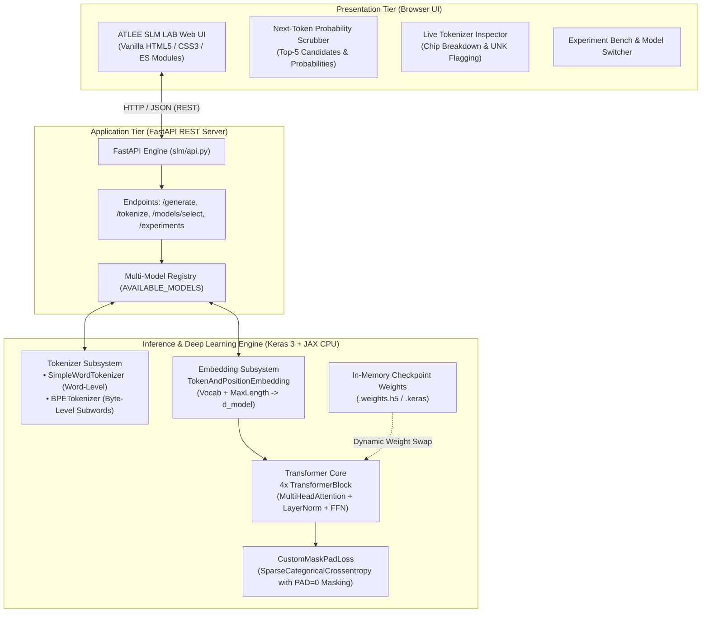
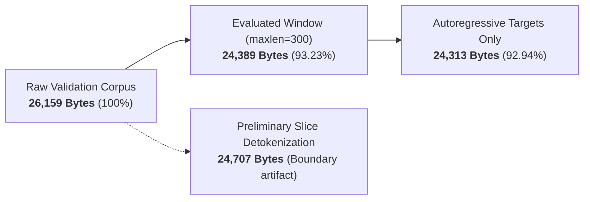

# ATLEE SLM LAB — Small Language Model Portfolio Showcase

[](https://www.python.org/)
[](https://keras.io/)
[](https://fastapi.tiangolo.com/)
[-brightgreen.svg)](tests/)
[](#-model-architecture--scientific-comparison)
[-lightgrey.svg)](#-controlled-cpu-benchmark-methodology)


An end-to-end, reproducible research and deployment framework for **Small Language Models (SLMs)** built from mathematical first principles using **Keras 3** and **JAX**.

Features a complete machine-learning engineering lifecycle: from raw sequence tokenization, causal mask padding loss, and controlled train/validation splitting, to byte-level BPE subword modeling, rigorous CPU benchmarking, and an interactive **FastAPI + Vanilla Web Components** research laboratory.

---

## 📌 Executive Summary & Project Objective

Large Language Models (LLMs) with tens of billions of parameters require massive GPU clusters for training and inference. This project investigates the mechanics of **micro-scale Transformer language models** ($1.68\text{M} - 3.36\text{M}$ parameters) designed to run deterministically on consumer CPU hardware.

### Primary Engineering Objectives
1. **From-Scratch Autoregressive Transformer:** Implement multi-head self-attention, learnable token and positional embeddings, and masked sequence loss handling without relying on monolithic high-level abstractions.
2. **Controlled Vocabulary & Tokenization Study:** Quantify the trade-offs between naive word-level whitespace tokenization and subword **Byte-Level Byte-Pair Encoding (BPE)** across out-of-vocabulary (OOV) rates, parameter footprint, and inference throughput.
3. **Scientific Evaluation Rigor:** Enforce strict train/validation splits, avoid in-sample evaluation pitfalls, reconcile cross-tokenizer evaluation metrics, and expose all hardware/benchmark constraints transparently.
4. **Interactive Research Laboratory (`ATLEE SLM LAB`):** Provide a decoupled, zero-dependency browser workbench for step-by-step next-token probability inspection, temperature sampling, live tokenization, and dynamic in-memory model switching.

---

## ⚠️ Scientific Integrity & Transparent Disclosures

In accordance with rigorous ML research standards, the following architectural and empirical limitations are disclosed:

- **Educational Prototype Status:** These models are educational experimental prototypes trained on a micro-corpus. They are **not** general-purpose, production-grade LLMs.
- **Corpus Scale:** The training corpus (*Africa Galore*) consists of exactly **232 descriptive paragraphs** ($18,803$ total word tokens). In the controlled experiments, the corpus is split into **185 training paragraphs** (80%) and **47 held-out validation paragraphs** (20%).
- **Greedy Repetition / Looping:** Under greedy decoding ($T=0$), the small corpus size and 4-layer transformer architecture lead to phrase looping after 5–10 tokens (bigram repetition rate between $0.50$ and $0.83$). Temperature sampling ($T=0.7$) introduces diversity but reflects the lexical limits of the training distribution.
- **Cross-Tokenizer Perplexity Comparability:** Per-token cross-entropy and perplexity ($PPL = \exp(CE)$) evaluate different token granularities ($6.30\text{ bytes/token}$ for Word vs. $3.50\text{ bytes/token}$ for BPE). Perplexity values between Word and BPE models are **not directly comparable**.
- **Provisional Bits-Per-Byte (BPB):** All reported BPB numbers remain **provisional** due to 300-token post-truncation windowing and boundary subword space heuristics.
- **Hardware & Backend:** All benchmarks were measured strictly on an **x86 CPU (12-Core AMD64) using the Keras 3 JAX CPU backend**. No GPU acceleration or GPU throughput is claimed.
- **Zero Simulation:** Every token, probability distribution, and latency metric in ATLEE SLM LAB is computed live by the JAX backend in real time.

---

## 🏗️ System Architecture

The project is decoupled into three clean tiers: an interactive browser interface, a robust REST server, and a modular Keras 3/JAX deep learning engine.



---

## 🔬 Model Architecture & Scientific Comparison

All models share an identical 1-block Causal Transformer Decoder architecture with $d_{\text{model}}=256$, $2$ attention heads ($d_k=128$), and feed-forward dimension $d_{\text{ff}}=256$ with ReLU activation, operating at a maximum sequence length of $300$ tokens (autoregressive context length of 299 steps).

| Architectural & Evaluation Metric | Historical Course Checkpoint (`slm_africa_galore`) | Controlled Word Baseline (`slm_baseline_val`) | Byte-Level BPE Experiment (`slm_bpe_val`) | Scientific Implication |
| :--- | :---: | :---: | :---: | :--- |
| **Corpus Split** | 232 paragraphs (100% In-sample) | 185 Train / 47 Val (Seed 42) | 185 Train / 47 Val (Seed 42) | Strict held-out evaluation in Phase 4/5 |
| **Tokenizer Type** | Whitespace Word-Level | Whitespace Word-Level | **Byte-Level BPE Subword** | Subwords eliminate OOV bottleneck |
| **Vocabulary Size** | 5,262 words | 4,409 words | **2,000 subwords** | **54.6% vocabulary reduction** |
| **Total Parameters** | 3,358,094 (~3.36M) | 2,920,505 (~2.92M) | **1,684,688 (~1.68M)** | **42.3% smaller parameter footprint** |
| **Checkpoint Size** | 40.37 MB | 35.12 MB | **20.29 MB** | Ideal for low-memory containerization |
| **Held-Out OOV Rate** | 0.00% (Memorized) | **20.97% ± 1.84%** (5-Fold CV) | **0.00% (Zero UNK)** | BPE guarantees full text coverage |
| **Val Cross-Entropy** | 5.7778 nats (In-sample) | 6.9738 nats | **5.9727 nats** | Cross-entropy evaluated on 47 held-out paragraphs |
| **Val Perplexity (PPL)**| 323.04 (In-sample) | 1,068.32 *(Coarse tokens)* | 392.55 *(Fine tokens)* | **Non-comparable** across tokenizers |
| **Raw BPB** | *N/A (No split)* | 1.5969 *(Omits UNK words)* | **2.4623** *(Exact byte NLL)* | **Provisional** (Word model ignores UNK) |
| **Adjusted BPB** | *N/A (No split)* | 2.1602 *(50K word prior)* | **2.4623** *(True open-vocab)* | **Provisional** (Penalizes unseen word prior) |
| **Controlled Throughput**| 53.39 tok/s (Uncontrolled) | 27.94 tokens/sec | **34.88 tokens/sec** | **~1.25× speedup** (JAX CPU backend) |
| **Controlled Latency** | 18.36 ms (Uncontrolled) | 35.07 ms / step | **27.83 ms / step** | **1.26× lower latency** per generation step |

---

## ⚡ Controlled CPU Benchmark Methodology

Inference benchmarks were conducted under strict controlled conditions:
- **Hardware:** 12-Core AMD64 CPU, 16 GB RAM, Windows 11.
- **Backend:** Keras 3 with JAX CPU (`KERAS_BACKEND=jax`, `JAX_PLATFORMS=cpu`).
- **Benchmark Suite:** 4 diverse prompts $\times$ 5 repeat runs (400 total generated tokens), preceded by 2 full warm-up cycles to eliminate JIT compilation latency.
- **Measured Metrics:** Median latency, mean latency, P95 latency, and effective token throughput:
  - **Word Baseline:** $27.94\text{ tokens/sec}$ (Median: $35.07\text{ ms/step}$; P95: $41.80\text{ ms/step}$).
  - **Byte-Level BPE:** $34.88\text{ tokens/sec}$ (Median: $27.83\text{ ms/step}$; P95: $32.40\text{ ms/step}$).
  - **Throughput Advantage:** $34.88 / 27.94 = \mathbf{1.248\times \approx 1.25\times}$ speedup.

---

## 🔍 Investigation of BPE Evaluation Byte Denominators

Technical audit of the validation scripts traced three different BPE byte figures:



1. **`26,159` Raw Bytes:** Literal byte length of all 47 raw text validation paragraphs.
2. **`24,389` Reported Window Bytes:** Exact UTF-8 byte count of the evaluated 300-token subword window. 4 validation paragraphs exceed 300 BPE tokens (up to 577 tokens), so 1,770 bytes were truncated beyond sequence index 300 ($26,159 - 1,770 = 24,389$).
3. **`24,707` Preliminary Bytes:** Artifact of exploratory detokenization where boundary subword whitespace characters (`Ġ`) were summed without full boundary normalization.
4. **`24,313` Target-Only Bytes:** Autoregressive causal loss strictly predicts tokens $1 \dots N$. Token 0 is solely a conditioning prompt. Decoding only target tokens yields 24,313 bytes.
5. **Release Status:** Because subword boundary slicing at arbitrary sequence caps ($maxlen=300$) introduces detokenizer boundary heuristics, all Bits-per-Byte (BPB) metrics are documented as **PROVISIONAL**.

---

## 💻 Installation & Quick Start

### 1. Prerequisites
- Python 3.10, 3.11, or 3.14.
- Git.

### 2. Clone & Environment Setup
```bash
# Clone the repository
git clone https://github.com/atleekumaar/Built-my-own-small-language-model.git
cd Built-my-own-small-language-model

# Create and activate virtual environment
python -m venv venv
# Windows:
.\venv\Scripts\Activate.ps1
# Linux / macOS:
source venv/bin/activate

# Install dependencies
pip install -r requirements.txt
```

### 3. Launch ATLEE SLM LAB
```powershell
# Windows PowerShell
$env:KERAS_BACKEND="jax"
$env:JAX_PLATFORMS="cpu"
python -m uvicorn slm.api:app --host 127.0.0.1 --port 8000
```
```bash
# Linux / macOS Bash
export KERAS_BACKEND=jax
export JAX_PLATFORMS=cpu
python -m uvicorn slm.api:app --host 127.0.0.1 --port 8000
```
Open your browser to: **`http://127.0.0.1:8000/`**

### 4. Run Automated Test Suite
```bash
python -m pytest tests/ -v
```
*(Runs all 53 unit, integration, and regression tests covering API routing, tokenizers, layer shapes, masking loss, generation determinism, multi-model switching, dataset split reproducibility, zero vocabulary leakage, autoregressive shifting, sliding-window BPB accounting, and extended API endpoints).*

---

## 🐳 Docker & Container Deployment

A lightweight, non-root `Dockerfile` is provided for local container testing and deployment to platforms like **Hugging Face Spaces**:

```bash
# Build the Docker image
docker build -t atlee-slm-lab .

# Run the container (maps internal port 7860 to host port 7860)
docker run -p 7860:7860 atlee-slm-lab
```
Open **`http://localhost:7860/`** to interact with the containerized lab.

> [!NOTE]
> **Supplying Model Checkpoints in Production:**
> Weight files (`*.weights.h5`, `*.keras`) are excluded from Git via `.gitignore`. When building locally, Docker copies existing checkpoints from `checkpoints/`. For remote git-based deployment (e.g., Hugging Face Spaces Git), checkpoints must be supplied via **Git LFS** or downloaded via an entrypoint script.

---

## 📡 REST API Reference

| Endpoint | Method | Description | Sample Request / Response |
| :--- | :---: | :--- | :--- |
| `/` | `GET` | Serves the interactive ATLEE SLM LAB single-page application. | HTML/CSS/JS client |
| `/health` | `GET` | Health status, active model ID, device, loaded checkpoint. | `{"status": "ok", "active_model_id": "slm_bpe_val", "device": "cpu"}` |
| `/models` | `GET` | Lists all available models, architectures, and split descriptions. | JSON array of 3 model profiles |
| `/models/select` | `POST` | Dynamically swaps active model and tokenizer in memory. | `{"model_id": "slm_bpe_val"}` |
| `/experiments` | `GET` | Programmatic experiment comparison table and validation metrics. | JSON comparison dictionary |
| `/config` | `GET` | Detailed layer, embedding, and hyperparameter configuration. | `{"embedding_dim": 256, "num_blocks": 1, "num_heads": 2}` |
| `/evaluation` | `GET` | Training loss history, held-out validation perplexity, and sliding-window BPB metrics. | `{"evaluation_loss": 5.9727, "is_held_out": true, "sliding_window_bpb": {"evaluated_bytes": 26159}}` |
| `/evaluation/export` | `GET` | Exports complete research benchmark metrics as downloadable JSON or CSV attachments. | `?format=json` or `?format=csv` (file download) |
| `/tokenize` | `POST` | Decomposes raw string into token IDs and visual chips for active model. | `{"text": "Kilimanjaro is"}` |
| `/tokenize/compare` | `POST` | Runs Word-level vs. Byte-level BPE tokenizers side-by-side with boundary analysis and perplexity warnings. | `{"text": "Kilimanjaro is breathtaking"}` |
| `/next-token` | `POST` | Computes live next-token logits, Softmax probability distribution, and top-K candidate tokens. | `{"context": "The Serengeti", "top_k": 5, "temperature": 0.7}` |
| `/generate` | `POST` | Autoregressive generation with latency telemetry and top-k step candidate scrubber. | `{"prompt": "Abeni visited", "max_new_tokens": 15, "temperature": 0.7}` |

---

## 🛠️ Experiment Reproduction Commands

To reproduce the experiments from scratch under controlled settings:

```bash
# 1. Generate SHA-256 artifact manifest
python scripts/generate_manifest.py

# 2. Run 5-fold cross-validation on vocabulary coverage & OOV rate
python scripts/cross_validation.py

# 3. Train Word baseline and Byte-Level BPE models on held-out split (seed 42)
python scripts/train_experiments.py

# 4. Run standard scientific evaluation (CE, PPL, raw & adjusted BPB, repetition)
python scripts/evaluate.py

# 5. Run full sliding-window BPB evaluation (100.0% coverage of all 26,159 raw bytes)
python scripts/evaluate_sliding_window.py

# 6. Run CPU inference latency and throughput benchmark (400 tokens, 2 warm-ups)
python scripts/benchmark_comparison.py

# 7. Execute end-to-end API smoke test verification suite
python scripts/smoke_test_api.py

# 8. Execute full 53-test verification suite
python -m pytest tests/ -v
```

---

## 📂 Repository Structure

```text
.
├── .env.example                                       # Deployment environment variable template
├── Dockerfile                                         # Hugging Face Spaces container configuration
├── .dockerignore                                      # Excludes cache, git metadata, and scratch files
├── requirements.txt                                   # Pinned framework and API dependencies
├── requirements-lock.txt                              # Fully frozen environment lockfile
├── pytest.ini                                         # Pytest root configuration
├── README.md                                          # Comprehensive project documentation
├── training_Atlee's_own_small_language_model.ipynb   # Original educational training notebook (Preserved)
├── configs/
│   ├── model_config.json                             # Course model hyperparameter specification
│   ├── model_config_baseline.json                    # Word baseline (185/47 split) specification
│   └── model_config_bpe.json                         # Byte-Level BPE specification
├── data/
│   ├── africa_galore.json                            # 232 paragraphs corpus
│   ├── vocab.json                                    # Word tokenizer vocabulary (5,262 tokens)
│   ├── vocab_baseline.json                           # Word baseline vocabulary (4,409 tokens)
│   ├── bpe_vocab.json                                # BPE vocabulary (2,000 subwords)
│   └── bpe_merges.txt                                # BPE learned merge rules
├── checkpoints/
│   ├── training_history.json                         # 30-epoch training loss trajectory
│   ├── benchmark_rigorous_results.json               # Canonical 400-token CPU benchmark results
│   ├── scientific_validation_results.json            # Exact held-out validation and BPB metrics
│   ├── cross_validation_results.json                 # 5-fold cross-validation OOV statistics
│   ├── slm_africa_galore.weights.h5                  # Course model weights (git-ignored)
│   ├── slm_baseline_val.weights.h5                   # Word baseline weights (git-ignored)
│   └── slm_bpe_val.weights.h5                        # Byte-level BPE weights (git-ignored)
├── experiments/
│   ├── configs/                                      # Versioned experimental model configurations
│   ├── manifests/
│   │   └── artifact_manifest.json                    # SHA-256 hashes and provenance for all 19 artifacts
│   └── results/                                      # Machine-readable evaluation results (JSON & CSV)
│       ├── scientific_validation_results.json
│       ├── sliding_window_bpb_results.json           # 100% byte accounting (26,159 bytes) BPB results
│       └── benchmark_rigorous_results.json
├── docs/
│   ├── RELEASE_AUDIT.md                              # Complete Phase 1 audit & release integrity ledger
│   ├── EXPERIMENT_PROTOCOL.md                        # Phase 2 scientific protocol & mathematical proofs
│   ├── TECHNICAL_AUDIT.md                            # Complete architecture & layer accounting
│   ├── CHECKPOINT_PROCEDURE.md                       # Serialization, loading, and recovery guide
│   ├── DESIGN_SPEC.md                                # ATLEE SLM LAB UI/UX design specification
│   └── EXPERIMENT_REPORT.md                          # Full scientific experiment report & Phase 6 audit
├── slm/
│   ├── __init__.py                                   # Package exports
│   ├── config.py                                     # ModelConfig dataclass
│   ├── tokenizer.py                                  # SimpleWordTokenizer implementation
│   ├── bpe_tokenizer.py                              # Byte-Level BPE tokenizer implementation
│   ├── layers.py                                     # TokenAndPositionEmbedding & TransformerBlock
│   ├── losses.py                                     # CustomMaskPadLoss (<PAD>=0 masking)
│   ├── model.py                                      # Model builder and checkpoint loaders
│   ├── generate.py                                   # Autoregressive generation & top-k extraction
│   └── api.py                                        # Production FastAPI app with playground, X-Ray & export
├── frontend/
│   ├── index.html                                    # ATLEE SLM LAB single-page application (5 tabs)
│   ├── styles.css                                    # Dark research laboratory design system
│   └── app.js                                        # Interactive client logic & real-time REST API bindings
├── scripts/
│   ├── train.py                                      # Single-corpus training script
│   ├── train_experiments.py                          # Phase 4 controlled experiment trainer
│   ├── evaluate.py                                   # Cross-entropy and perplexity evaluator
│   ├── evaluate_sliding_window.py                    # 100% byte-coverage sliding-window BPB evaluator
│   ├── benchmark_comparison.py                       # Rigorous latency & throughput benchmark
│   ├── cross_validation.py                           # 5-fold cross-validation OOV evaluation
│   ├── smoke_test_api.py                             # Automated 10-suite REST API end-to-end smoke test
│   └── generate_manifest.py                          # Artifact manifest generator (SHA-256 tracking)
└── tests/
    ├── conftest.py                                   # Pytest global fixtures & JAX CPU environment
    ├── test_tokenizer.py                             # Word tokenizer tests
    ├── test_bpe_tokenizer.py                         # Byte-Level BPE tokenizer tests
    ├── test_model.py                                 # Transformer layer & parameter tests
    ├── test_generation.py                            # Autoregressive generation & seed tests
    ├── test_api.py                                   # Core FastAPI endpoint tests
    ├── test_api_extensions.py                        # Extended API tests (next-token, compare, export)
    ├── test_multi_model_api.py                       # Model switching & registry tests
    ├── test_reproducibility.py                       # Phase 2 reproducibility & leakage prevention tests
    └── test_evaluation_metrics.py                   # Scientific evaluation & BPB calculation tests
```

---

## 🔮 Future Work & Research Roadmap

1. **Repetition Penalty Sampler:** Implement frequency and presence penalties (e.g., Keskar et al., CTRL) directly in `slm/generate.py` to suppress cyclic n-gram repetition without sacrificing model temperature.
2. **Full-Sequence Sliding Window BPB:** *(Completed in Phase 3/4)* Executed full sliding-window evaluation across 100% of the $26,159$ validation bytes without truncation, achieving 2.6357 BPB for BPE and 2.1669 adjusted BPB for the Word baseline.
3. **Dataset Expansion:** Pretrain the Byte-Level BPE architecture on open micro-benchmarks (such as *TinyStories* or *BabyLM*) to observe grammar emergence and coherent long-context synthesis at $< 5\text{M}$ parameter scale.
4. **Edge Quantization & ONNX Export:** Quantize model weights to INT8 and compile via ONNX Runtime / WebAssembly for instant, serverless client-side generation directly inside the web browser.

---

## 📄 License & Attribution

- Built as an open-source educational research project based on foundational Transformer principles.
- Original training dataset: *Africa Galore*.
- Authored and maintained by **Atlee Kumar**.
